# Anatomía de un Foundational Model en JAX: Tokenización, Atención, KV-Cache y Sampling Loop para Software Devs

- **Por qué es relevante:** Abrir un *Foundational Model* estilo Gemma desde la perspectiva de ingeniería de sistemas muestra que un LLM es un pipeline de estructuras de datos en memoria con formas bien definidas: un compresor sin pérdida (`BPE`), un diccionario diferenciable con rotación relativa (`Self-Attention` + `RoPE`), bloques modulares (`RMSNorm` + `Grouped-Query Attention` + `GeGLU`), un buffer prealocado (`KV-cache`) y un filtro estadístico sobre `logits` (`Sampling Loop`).
- **Para quién es:** Ingenieros de software y desarrolladores backend que ya conocen los fundamentos de JAX, redes neuronales y embeddings, y quieren entender qué ocurre exactamente en memoria durante las fases de `prefill` y `decode` de un modelo fundacional moderno sin depender de cajas negras.
- **Quién debería verlo:** Equipos que diseñan motores de inferencia, agentes con salidas estructuradas (`JSON Grammar Mask`), optimización de latencia o dimensionamiento de memoria de `KV-cache` sobre CPU, GPU o Cloud TPU.
- **Qué es y qué no es:** Aquí no se carga un checkpoint real de Gemma. Son bloques estilo Gemma en JAX puro, con dimensiones de juguete y pesos aleatorios, que no generan texto con sentido. Lo real son las formas, los mecanismos y los costos. Todo se midió en la CPU de una laptop; nada se afirma sobre TPU o GPU.
- **Serie completa:** Cuarta entrega de la Serie B [JAX & ML for Software Devs Field Guide](https://github.com/ykro/jax-ml-for-software-devs-field-guide).

---

## Arquitectura y Modelo Mental

### 1. El Stack de Estructuras de Datos de un Foundational Model

Un modelo fundacional transforma un `string` UTF-8 en el siguiente token atravesando seis capas con invariantes de forma explícitos: compresión de bytes a sub-palabras con Byte-Pair Encoding (`int32[B, T]`), lectura en la tabla de embeddings escalada por `sqrt(d_model)` (`float32[B, T, D]`), `N` bloques estilo Gemma que preservan la forma del tensor residual (`RMSNorm`, `Grouped-Query Attention` con razón 8:2 y compuerta `GeGLU`), proyección final a `logits` sobre el vocabulario (`float32[B, V]`) y el `sampling loop` autorregresivo.



### 2. Fase `Prefill` vs Fase `Decode` con `KV-Cache` Estático

Durante la generación autorregresiva, recalcular toda la secuencia en cada paso desperdicia cómputo porque la máscara causal garantiza que las keys (`K`) y values (`V`) de los tokens pasados nunca cambian. El `prefill` procesa el prompt en paralelo y guarda sus `K` y `V` en un buffer prealocado; cada paso de `decode` calcula solo la query, la key y el value del token nuevo y escribe esa key y ese value con `jax.lax.dynamic_update_slice`. Escribir cuesta lo mismo en cualquier posición, pero la query nueva se compara contra todas las keys guardadas, así que **cada paso de decode sigue creciendo con el contexto**: el cache elimina el recálculo del prefijo, no hace que un token cueste `O(1)`. El experimento 04 lo mide con un solo paso de decode sobre buffers de 128, 1024 y 8192 posiciones.



### 3. Pipeline del `Sampling Loop`: De `Logits` a Token ID con Máscara de Gramática

Un modelo fundacional termina cada pasada entregando un vector plano de `logits` (`float32[B, V]`). Antes de invocar al generador pseudoaleatorio Threefry (`jax.random.categorical`), el `sampling loop` aplica una máscara booleana de gramática o esquema JSON (`jnp.where(allowed_mask, logits, -1e9)`), escala la entropía con `temperature` y recorta la cola de ruido con `jax.lax.top_k` (`Top-K`) y probabilidad acumulada (`Top-P`). En el repo los logits son aleatorios y la gramática es una secuencia fija de conjuntos permitidos sobre un vocabulario de juguete; un decoding con restricciones de verdad necesita una máquina de estados que avance con cada token y un tokenizador real.



---

## Resultados Reales de Verificación (`verify_anatomy.py`)

Una corrida de `make all` en CPU (`Apple M1 Max`, 10 núcleos, load average de 1 minuto `21.65` al empezar: la máquina estaba cargada), Python `3.12.11`, JAX `0.12.0.1` y NumPy `2.5.4`. Las cifras de esta tabla son las de `benchmarks/latest_results.json`.

| Experimento | Baseline ingenuo | Resultado en JAX | Referencia justa y verificaciones |
| :--- | :--- | :--- | :--- |
| **01. BPE y gather de embeddings** | `for-loop` de Python que copia 16,384 filas una por una: `12.9598 ms` | `@jax.jit` gather: `0.3221 ms` (**40.23x**) | NumPy vectorizado `emb[ids]`: `1.1806 ms`, el jit gana **3.67x**. BPE: 384 tokens (256 bytes + 128 fusiones), round-trip exacto, oración del corpus `175 → 79` tokens (`2.22x`), oración que no estaba en el corpus `86 → 54` (`1.59x`) |
| **02. Atención causal + RoPE** | NumPy con un loop de Python sobre las 64 combinaciones batch × cabeza: `6.5550 ms` | `@jax.jit`: `1.1320 ms` (**5.79x**) | NumPy batched sin loop de Python: `5.3277 ms`, el jit gana **4.71x**. Fuga causal `0.0`, error de RoPE `1e-06` (redondeo de float32). HLO compilado: 7 fusiones y 2 `dot` |
| **03. Bloque estilo Gemma (RMSNorm + GQA + GeGLU)** | JAX eager: `6.5208 ms` | `@jax.jit`: `3.6783 ms` (**1.77x**) | 88 operaciones de primer nivel despachadas una por una en eager contra 30 fusiones (9 `dot`) en el HLO. K/V guardados por capa `2048 → 512 KB` (8 cabezas de query, 2 de K/V; aritmética de formas, no memoria medida) |
| **04. KV-cache, prefill 64 + decode 64** | Recalcular la ventana completa de 128 posiciones en cada paso: `423.1220 ms` | `prefill` + `KV-cache`: `33.6515 ms` (**12.57x**) | Las dos versiones compiladas con `@jax.jit` dentro de `lax.scan` (comparación justa; el speedup es del algoritmo). 256/256 tokens generados idénticos, diferencia máxima de logits `8e-06`. Un paso de decode: `0.5831 ms` con 128 posiciones, `2.0352 ms` con 1024, `11.9785 ms` con 8192 |
| **05. Sampling loop + máscara de gramática** | Loop de Python por paso y por fila con `argsort` del vocabulario: `68.0771 ms` | `@jax.jit` + `lax.scan`: `3.1686 ms` (**21.48x**) | Loop de Python que llama a un paso compilado: `6.1462 ms`, el scan gana **1.94x** (mismos tokens). Máscara respetada en 2048/2048 sorteos (100%, por construcción). Con `T=1e-4`, Top-K=16 y Top-P=0.90, 64/64 filas igual a argmax |

### Cómo leer estas cifras

- **Es un modelo de juguete.** Bloques estilo Gemma con dimensiones pequeñas y pesos aleatorios. El experimento 04 es un decoder de 4 capas aún más simple: GQA 4:2, MLP con GELU sin compuerta y sin RoPE.
- **Las verificaciones son deterministas; los tiempos no.** Round-trip, fuga causal, paridad numérica, tokens idénticos y máscara salen de semillas fijas y se repiten en cada corrida. Cada tiempo es la mediana después de una llamada de calentamiento (`block_until_ready()` en todas las ramas de JAX) y cambia entre corridas, sobre todo con la máquina cargada. Cada script imprime su propia medición, así que sus tiempos no coinciden con los de esta tabla. Importa el orden de magnitud.
- **Cada «Nx» dice contra qué compara.** El `40.23x` del 01 mide sobre todo el costo de recorrer filas desde Python; contra NumPy vectorizado el jit gana `3.67x`. El `5.79x` del 02 compara contra un loop de Python sobre cabezas; contra NumPy batched queda en `4.71x`, así que casi toda la ventaja viene de la matemática compilada. El `21.48x` del 05 compara contra un loop en el host que ordena el vocabulario completo; contra un loop que ya llama a un paso compilado, `lax.scan` gana `1.94x` por no volver a Python en cada token.
- **El bloque gana poco con jit, y tiene sentido.** Casi todo el trabajo son multiplicaciones de matrices que ya corren en kernels optimizados en eager; el compilador gana fusionando las operaciones pequeñas de alrededor y evitando su dispatch. El HLO tiene varias fusiones, no un solo kernel.
- **El `4.00x` de GQA es aritmética de formas** (8 cabezas de query entre 2 de K/V). Dentro del bloque K y V se repiten con `jnp.repeat` para atender, así que baja lo que guardas y lees de memoria, no el cómputo de la atención.
- **El KV-cache no hace que un token cueste `O(1)`.** Escribir la key nueva cuesta lo mismo en cualquier posición, pero la query se compara contra todo el buffer: un paso de decode pasa de `0.58 ms` a `11.98 ms` al ir de 128 a 8192 posiciones. Aquí el buffer tiene tamaño fijo (jit necesita formas estáticas) y una máscara apaga las posiciones vacías.
- **El 100% de la gramática está garantizado por construcción.** Los logits son aleatorios y la gramática es una secuencia fija de 8 conjuntos permitidos sobre un vocabulario de juguete. Prueba que la máscara se aplica antes de sortear en todos los pasos, no que un modelo produzca JSON.
- **La compresión de BPE es optimista dentro del corpus.** El tokenizador se entrenó sobre un párrafo que contiene la oración de prueba (`2.22x`); con una oración que no estaba en el corpus baja a `1.59x`. El «4.91x menos pares» es el cuadrado de `2.22`, aritmética, no un tiempo medido.

Salida íntegra de terminal generada por `verify_anatomy.py` en esa corrida:

```text
================================================================================================
THE OUTSIDE JUDGE — Foundational Models Anatomy in JAX Verification Report
================================================================================================
Runtime : Python 3.12.11 | JAX 0.12.0.1 | NumPy 2.5.4 | Backend: cpu
CPU     : Apple M1 Max (10 cores) | 1-min load average 21.65 before, 17.92 after
Model   : toy Gemma-style blocks, random weights (no real checkpoint)
------------------------------------------------------------------------------------------------
Experiment                      | Baseline              | JAX/OpenXLA      | Speedup
------------------------------------------------------------------------------------------------
01. Embedding gather (BPE ids)  | loop 12.96 ms         | @jit 0.322 ms    | 40.23x
    fair: NumPy emb[ids] 1.181 ms -> @jit 3.67x; BPE 175 B -> 79 tok in-sample, held-out 1.59x
02. Causal attention + RoPE     | NumPy loop 6.55 ms    | @jit 1.132 ms    | 5.79x
    fair: NumPy batched 5.33 ms -> @jit 4.71x; leak 0.0; HLO 7 fusions
03. Gemma-style block           | eager 6.52 ms         | @jit 3.678 ms    | 1.77x
    K/V stored 2048 -> 512 KB (8/2 heads, arithmetic); 88 eager ops -> 30 fusions
04. KV-cache, 64 + 64 tokens    | recompute 423.1 ms    | cache 33.65 ms   | 12.57x
    fair: both @jit+scan; 256/256 tokens equal; one decode step 0.58 -> 11.98 ms, 128 -> 8192 slots
05. Sampling loop + mask        | host loop 68.1 ms     | scan 3.169 ms    | 21.48x
    fair: Python loop of @jit step 6.15 ms -> scan 1.94x; mask applied 100% (by construction)
------------------------------------------------------------------------------------------------
Checks are deterministic (fixed seeds). Times are medians after a warmup and vary
run to run.
Saved JSON report to: benchmarks/latest_results.json
ALL DETERMINISTIC CHECKS PASSED.
```

---

## Estructura del Repositorio

```text
.
├── benchmarks/
│   ├── latest_results.json                          # Métricas verificadas por verify_anatomy.py
│   └── terminal_output.txt                          # Salida íntegra del Outside Judge
├── diagrams/
│   ├── 01-foundational-model-data-structures.{html,svg,png}
│   ├── 02-prefill-vs-kv-cache-decode.{html,svg,png}
│   └── 03-logits-to-token-sampling-pipeline.{html,svg,png}
├── experiments/
│   ├── 01_bpe_tokenizer_as_data_compression.py      # Tokenizador BPE reversible y gather compilado
│   ├── 02_self_attention_as_soft_dictionary.py      # Diccionario suave Q/K/V, máscara causal y RoPE
│   ├── 03_gemma_block_rms_geglu.py                  # Bloque estilo Gemma: RMSNorm, GQA (8:2) y GeGLU
│   ├── 04_kv_cache_prefill_vs_decode.py             # Prefill vs Decode con KV-cache y costo de un paso según el largo del cache
│   └── 05_sampling_loop_temperature_top_p.py        # Sampling loop con Temperature, Top-K, Top-P y JSON mask
├── gcp/
│   └── run_on_demand_anatomy.sh                     # Runner on-demand con auto-teardown en Cloud TPU v5e y L4 GPU
├── tests/
│   └── test_anatomy.py                              # Suite pytest (5 tests)
├── Makefile
├── pyproject.toml
└── verify_anatomy.py                                # El Outside Judge (verificaciones, tiempos y entorno)
```

---

## Onboarding Paso a Paso

### 1. Instalación desde cero (macOS / Linux)

```bash
git clone https://github.com/ykro/foundational-models-anatomy-in-jax.git
cd foundational-models-anatomy-in-jax
python3 -m venv .venv
source .venv/bin/activate
pip install --upgrade pip
pip install -e ".[dev]"
```

### 2. Recorrido guiado por los 5 experimentos (Orden recomendado)

Cada script se ejecuta en pocos segundos y desarma una pieza clave de un modelo fundacional moderno:

```bash
# Paso 1 — Tokenización Byte-Pair Encoding (BPE) como compresión sin pérdida y lookup en JAX
python experiments/01_bpe_tokenizer_as_data_compression.py

# Paso 2 — Self-Attention como diccionario diferenciable (Q, K, V), máscara causal y RoPE
python experiments/02_self_attention_as_soft_dictionary.py

# Paso 3 — Anatomía de un bloque estilo Gemma: RMSNorm, Grouped-Query Attention (GQA) y compuerta GeGLU
python experiments/03_gemma_block_rms_geglu.py

# Paso 4 — El KV-cache como estructura de datos en memoria: Prefill paralelo vs Decode
python experiments/04_kv_cache_prefill_vs_decode.py

# Paso 5 — El Sampling Loop autorregresivo: Temperature, Top-K, Top-P y máscara de gramática JSON
python experiments/05_sampling_loop_temperature_top_p.py
```

### 3. Verificación completa (Linter + Tests + Outside Judge)

```bash
# Ejecutar únicamente el Outside Judge y actualizar benchmarks/latest_results.json
python verify_anatomy.py

# Ejecutar ruff, pytest (5 tests) y verify_anatomy.py en un solo comando
make all
```

### 4. Ejecución on-demand con auto-teardown en Google Cloud (Cloud TPU v5e o NVIDIA L4 GPU)

El script `gcp/run_on_demand_anatomy.sh` aprovisiona instancias on-demand con auto-teardown en el proyecto `ai-experiments-487722` y garantiza la limpieza automática de los recursos mediante `trap cleanup EXIT INT TERM`.

```bash
# Ejecutar benchmark en una instancia on-demand de Cloud TPU v5e-1 (us-central1-a)
make gcp-tpu

# Ejecutar benchmark en un Vertex AI Custom Job on-demand con GPU NVIDIA L4
make gcp-gpu
```
